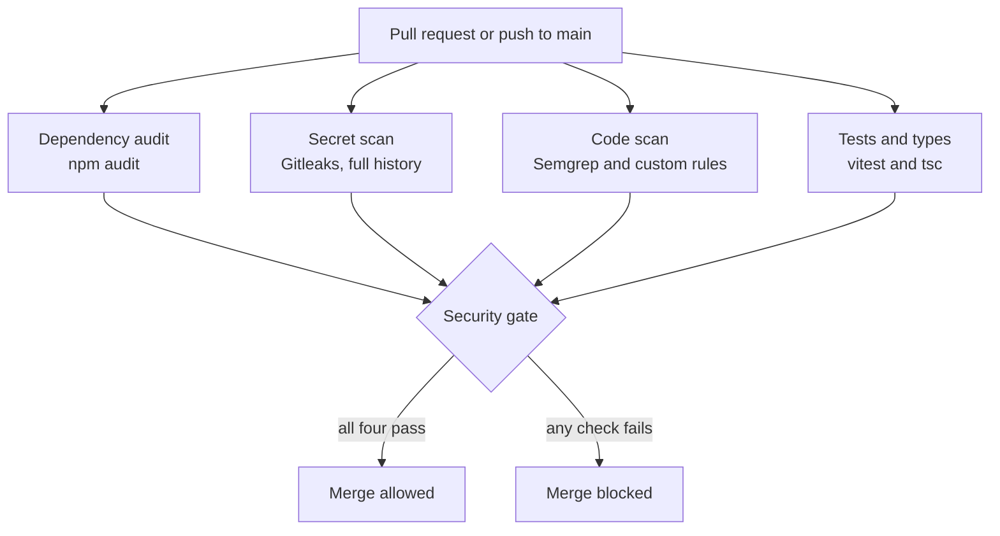

# Security Pipeline

Every pull request and every push to `main` runs through [`.github/workflows/security.yml`](../.github/workflows/security.yml). One job, the **Security gate**, passes only when all four checks pass. New advisories can appear when the code has not changed, so the pipeline also runs every Monday.

This pipeline turns part of the [threat model](https://github.com/Iamendlesss/the-watchman-threat-model) into checks that run on every change. It covers threats T-21 and T-22, and it guards controls the review confirmed are working.



## What blocks a merge

| Check | Blocks on | Reported only |
|---|---|---|
| Dependency audit | High or critical advisories with no valid exception | Moderate, low and info |
| Secret scan | Any secret anywhere in the history of the change | Nothing |
| Code scan | High severity (`ERROR`) findings | Lower severities, listed in the Security tab |
| Tests and types | Any failure | Nothing |

## Custom rules

The rules in [`security/semgrep/watchman-controls.yml`](../security/semgrep/watchman-controls.yml) protect things the threat model found working, so a later change cannot quietly remove them. Each rule has examples in [`security/semgrep/watchman-controls.ts`](../security/semgrep/watchman-controls.ts), and the pipeline tests the rules against those examples before it trusts them.

| Rule | What it stops | Threats |
|---|---|---|
| `watchman-no-signing-library` | Adding a wallet or signing library | T-19, T-25 |
| `watchman-no-trading-key-read` | Code reading the trading key from the environment | T-19 |
| `watchman-no-process-spawn` | Importing modules that can run other programs or code | T-21, T-24 |
| `watchman-no-dynamic-code` | Running a string as code | T-21, T-24 |
| `watchman-sql-from-data` | Building SQL from a value instead of using a placeholder | T-12 |

The test suite guards one more control: `tests/config.test.ts` fails if live mode stops being refused.

## How the pipeline protects itself

- **Pinned tools:** actions are pinned to full commit hashes, the Semgrep image to a digest, and the Gitleaks download to a checked SHA-256. A moved tag cannot change what runs.
- **Least privilege:** the workflow's token is read-only by default, and only the code scan job can write to the Security tab. No job has access to API keys.
- **No stored git credentials:** each checkout discards its token, so later steps cannot push.
- **Fails closed:** if `npm audit` returns anything unusable, or a severity is unknown, the gate blocks. It never assumes a missing result means safe.
- **No new runtime dependencies:** the audit gate uses only Node's standard library. Semgrep and Gitleaks run only in CI.

## Accepting a risk

Sometimes the right call is to accept a finding for a limited time, so the gate supports exceptions in [`security/audit-exceptions.json`](../security/audit-exceptions.json). An exception must name one advisory and one package, give a reason, and carry an expiry date. Once it expires, the build fails again, so nothing can be accepted and forgotten.

One exception is active, for a high severity `zod` advisory, and it expires on 1 February 2027. Only `src/config.ts` uses `zod`, on a local file, so network input cannot reach the affected code. The only fix is `zod` 4, and a trial upgrade failed 35 tests, including the risk defaults and the live-mode refusal. That makes it a planned migration, not a quick bump.

## Proof it works

| Run | Result | What it showed |
|---|---|---|
| [First run](https://github.com/Iamendlesss/the-watchman/actions/runs/41564012338) | Blocked | Three high advisories in the lockfile, in `vite`, `source-map-js` and `zod`. The logs also exposed a flaw in the pipeline itself: the rule tests found nothing to test and passed anyway. |
| [Second run](https://github.com/Iamendlesss/the-watchman/actions/runs/41564303338) | Blocked | Upgrading `vitest` cleared the development tools, and the rule tests now ran for real (5 of 5). `zod` still blocked. |
| [Third run](https://github.com/Iamendlesss/the-watchman/actions/runs/41564459816) | Passed | `zod` was accepted with a dated exception after testing the upgrade. |
| [Demo pull request](https://github.com/Iamendlesss/the-watchman/pull/2) | Blocked | Planted code that runs a coin name with `eval`, starts a shell, reads the trading key and holds a made-up API key. The Secret scan and Code scan failed while the audit and tests still passed. |

All three code problems in the demo were caught by the custom rules. The standard rulesets raised nothing at blocking severity, which is why rules written from the threat model are worth having.

## Run it locally

```bash
npm audit --package-lock-only --json > /tmp/audit.json
```

```bash
node scripts/audit-gate.ts /tmp/audit.json security/audit-exceptions.json
```
